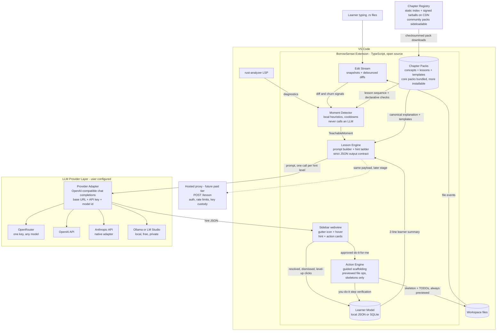

# Handout: Rust Pair-Teacher VS Code Extension ("BorrowSensei")

Everything discussed and researched so far, for continuing in a fresh chat. Two parts: the market research summary, then the full system design.

---

# PART 1 — MARKET RESEARCH SUMMARY

## The idea
A VS Code extension that continuously watches free-form Rust code as the learner writes it (editor APIs + rust-analyzer diagnostics, not screen capture), detects teachable moments, and teaches like a Socratic tutor instead of autocompleting — tiered hints, never writes solution code, tracks per-concept mastery over time.

## Bottom line from research
**This exact combination — editor-native watching + teach-not-autocomplete + Rust-first pedagogy + longitudinal concept tracking — does not exist yet. It's real whitespace.**

## Closest competitors
- **CodeTrain** (codetrain.ai) — Socratic tutor on your own codebase, explicitly anti-autocomplete ("Not autocomplete. Not a course generator"). Free tier (10 lessons/mo) / Pro $24/mo. Browser or localhost agent, **not a VS Code extension**. Python/JS/bash tracks, no Rust focus.
- **Sayagen "Coding Tutor AI"** — nearly identical framing to this idea: "a tutor that watches you code," triggers on long pauses/lingering errors/repeated deletes, hint ladder (question → reframed error → worked example), per-concept mastery dashboard. **Python-only, browser-only (Pyodide/WASM), no Rust, no editor integration.**
- **Exercism Rust track** — 99 exercises + free human mentoring focused on idiomatic Rust. Gold standard for "hints not answers" pedagogy but async/submission-based, not real-time.
- **Boot.dev** — "Boots," a Socratic AI tutor, ~$49/mo, no Rust course.
- **JetBrains RustRover** — bundles Rustlings + "100 Exercises to Learn Rust" + AI (Junie) inside the IDE. Closest Rust-in-IDE incumbent, but lesson-structured, not ambient/free-form.
- **GitHub Copilot / Cursor / Codeium / Cody / Continue.dev / Zed AI** — autocomplete/agent-first, opposite default behavior to what this product wants.
- **RustCoder** (Second State/CNCF) — a Rust-tuned LLM assistant with an MCP server; an embedded assistant, not a Socratic tutor. Notable technical reference.

## Rust-specific learning assets worth building on
- **Rustlings** — official, free, CLI, has a `watch` mode that auto-recompiles on save. The canonical "watch mode" prior art.
- **Brown University experimental Rust Book** (rust-book.cs.brown.edu) — instrumented 1.14M+ quiz answers across 62,526 readers; found **ownership is the #1 drop-off concept**; their intervention raised average "Ownership Inventory" scores from 48% to 57%. This is a validated conceptual model worth adapting (contact their Cognitive Engineering Lab before going deep on licensing).
- **100 Exercises to Learn Rust** (Luca Palmieri), **Tour of Rust**, **Rust by Example** — free interactive resources.
- Common borrow-checker error codes to build teaching around: **E0382, E0499, E0502, E0505, E0515, E0597, E0716** (plus E0106 lifetimes, E0277/E0308 traits, E0433/E0603 module/visibility).

## Enabling technology (all mature, low-risk)
- VS Code: `onDidChangeTextDocument`, `onDidSaveTextDocument`, `languages.getDiagnostics()` — no screen capture needed.
- rust-analyzer via LSP already surfaces rustc + clippy diagnostics.
- Existing open-source rust-analyzer MCP servers (zeenix/rust-analyzer-mcp, dexwritescode/rust-mcp) prove the "AI agent reads rust-analyzer" pattern.
- Live Share / Tuple / CodeTogether = prior art for "second presence" watching an editor comfortably.

## Market signals
- Rust: most-admired language 9 years running (83%, Stack Overflow 2024); ~2.27M developers used it in the last year (JetBrains survey); steep learning curve is the universal caveat.
- AI-tutor market estimates range widely by source: $2.1B–$3.55B (2025), projected to $6.45B–$17.7B by 2030–2033 (treat as directional, not precise — commercial research firms, definitions vary).
- EdTech VC funding fell to ~$2.4B in 2024, a decade low — capital is tight for a pure EdTech play.
- Pricing anchors in the space: Copilot Pro $10/mo, Cursor/Codecademy Plus ~$20/mo, CodeTrain Pro $24/mo, Boot.dev ~$49/mo. A Rust tutor would likely sit at **$15–25/mo**.
- Evidence AI autocomplete can hurt learning: Prather et al. (ICER 2024) on novice over-reliance; MIT Media Lab "Your Brain on ChatGPT" (Kosmyna et al. 2025) coined "cognitive debt" via EEG (small study, n=54, about essay writing — evidence is real but shouldn't be overstated; a counter-study, Kazemitabaar et al. CHI 2023, found AI code generators didn't reduce later unaided performance for novices).

## Gap analysis / strategic implications
- Whitespace = editor-native + free-form (not fixed exercises) + Rust-specific pedagogy + tiered hints + concept-mastery tracking. No one has all four.
- Main risk is **monetization**, not differentiation: strong free incumbents (Exercism, Rustlings, the Brown book, free-for-students Copilot) set a low willingness-to-pay ceiling.
- Recommended validation-first approach: ship a thin free prototype, get 20–50 real Rust learners, and check two things before investing further — (1) do ambient interruptions feel helpful or like noise? (2) does concept-mastery tracking change what people study? If interruptions read as "noisy autocomplete," pivot to on-demand-only.
- Positioning line that tested well against the research: **"the anti-Copilot for learning Rust — it refuses to write your code."**

---

# PART 2 — SYSTEM DESIGN (current state, in full)

Working name: **BorrowSensei** (placeholder). An open source, editor-native AI tutor that watches free-form Rust code, detects teachable moments, and teaches with tiered hints instead of writing code. Provider-agnostic: bring any OpenAI-compatible key (OpenRouter, OpenAI), an Anthropic key, or a free local model via Ollama.

## 1. Requirements

### Functional
- **F1. Watch** — observe `.rs` file edits in real time (debounced keystroke stream) and on save. Editor APIs only, no screen capture.
- **F2. Detect teachable moments** — trigger on: a lingering rust-analyzer diagnostic, repeated delete/rewrite churn in one region, idle-after-error, first-ever occurrence of an error code for this learner, or explicit user invocation.
- **F3. Teach with a hint ladder** — Level 1 Socratic question → Level 2 reframed error in the learner's own code terms → Level 3 worked example. Never skips levels without a click. Never writes solution code into the buffer (scaffolding is the one narrow exception, see F7).
- **F4. Track concept mastery** — a per-learner model mapping concepts (ownership, borrows, lifetimes, traits, error handling, etc.) to struggle/mastery scores, updated after every moment and resolution.
- **F5. Idiom flagging** — occasionally flags compiling-but-non-idiomatic patterns (e.g. reflexive `.clone()`) as low-priority lessons.
- **F6. On-demand mode** — everything must also work purely on request, for learners who find ambient nudges noisy (the research's #1 UX risk).
- **F7. Guided scaffolding** — when a lesson needs project structure (new file, module, test file, `cargo` command), the teacher proposes an **action card** with two paths: **"You do it"** (default — numbered steps, watcher live-verifies each one) or **"Do it for me"** (explicit per-action click — extension creates the file after a preview, containing only a commented skeleton with `todo!()` markers, then narrates what it did). The learner drives, the teacher suggests; solution code is never generated either way.
- **F8. Chapter packs** — teaching content ships as versioned, downloadable **chapter packs** installable independently of extension releases. A chapter bundles concept entries, a lesson sequence (scaffolds + declarative completion checks), Socratic templates, and worked examples. Core chapters ship bundled; more come from a registry; authors can sideload local packs. New pedagogy should never require a new extension version.
- **F8b. Whole-lifecycle interventions** — teaching moments aren't only compiler errors. The same trigger → card → learner-acts → verify grammar covers session warm-ups, just-ahead concept previews, success recognition, test coaching, clippy-as-curriculum, rabbit-hole rescue, prediction challenges, session recaps, and spaced review. (Full catalog below, section 3.8b.)
- **F9. Scaffold fading** — as a concept's mastery score rises, the teacher deliberately quiets down on it: fewer ambient nudges, hint ladder starts higher, eventually silence unless asked. A teacher whose goal is its own obsolescence is the anti-autocomplete principle applied over time.

### Non-functional
- **N1. Latency** — a hint renders within ~3–5s of trigger; detection itself is near-instant and fully local.
- **N2. Cost** — target < $0.02 per teachable moment; ~5–15 moments/hour of active learning; detection never calls an LLM, only teaching does.
- **N3. Privacy** — code leaves the machine only when a moment fires, only the relevant region + minimal context, visible/controllable. Learner model stays local by default.
- **N4. Reliability** — LLM outage degrades gracefully to `rustc --explain` text plus the stored concept explanation. Never blocks typing or the rust-analyzer pipeline.
- **N5. Interruption budget** — hard cap on ambient nudges (e.g. max 1 per 3 min, snoozeable) — "noisy autocomplete" is the documented failure mode of this category.

### Constraints
- Solo developer, evenings/weekends. TypeScript for the extension (v1) — conveniently not Rust, so the Rust learning happens through *using* the tool; an optional v2 backend rewrite in Rust is a capstone project.
- VS Code only for v1; rust-analyzer assumed installed.
- **Open source, provider-agnostic.** MVP ships with BYO credentials against any OpenAI-compatible endpoint (OpenRouter, OpenAI, Anthropic via native adapter, or local Ollama/LM Studio at zero cost). A thin proxy backend comes only at monetization.
- **No subscription piggybacking.** Claude Pro/Max OAuth is contractually restricted to Claude Code and claude.ai (server-side enforced since Jan 2026); ChatGPT subscriptions cover only OpenAI's own Codex products, not third-party API use. The extension will not depend on either.

## 2. High-Level Design

### Master system diagram



Everything left of the Provider Adapter is local and free. The only network egress is a fired teachable moment — and with Ollama, even that stays on the machine.

### Data flow (happy path)
1. Learner types; Edit Stream keeps a rolling snapshot per file and a debounced diff (idle threshold ~8s, plus on-save).
2. rust-analyzer publishes diagnostics; extension reads via `vscode.languages.getDiagnostics(uri)`.
3. Moment Detector runs cheap local heuristics (diff churn, diagnostic age, error-code novelty vs. learner model, idle time). Emits at most one `TeachableMoment` per cooldown window.
4. Lesson Engine builds a prompt: diagnostic(s), relevant code region (enclosing function, not whole file), the diff that led here, mapped concept, and a two-line learner-model summary. Calls the LLM requesting **Level 1 only**.
5. Sidebar renders the Socratic question. Buttons: "another nudge" (L2), "show me a worked example" (L3), "I solved it", "not now".
6. On resolution (diagnostic clears, or learner marks solved/dismissed), Learner Model updates the concept score and logs the episode.

## 3. Deep Dive

### 3.1 Concept taxonomy and error-code mapping
Static table shipped with the extension, adapted from the Brown University conceptual model:

| Concept | Signals |
|---|---|
| ownership / moves | E0382, E0505; `.clone()` churn |
| shared vs mutable borrows | E0499, E0502 |
| borrow lifetimes / dangling | E0597, E0515, E0716, E0106 |
| traits and bounds | E0277, E0308 (subset) |
| pattern matching / Option-Result | E0004, `unwrap()` density |
| idioms (non-error) | clippy lints, heuristic AST patterns |

This table is the pedagogical core and the cheapest moat: every entry gets a canonical mental-model explanation, 2–3 Socratic question templates, and a worked-example template. The LLM personalizes; the table keeps it grounded.

### 3.2 Learner model (data model)
Local JSON (v1) or SQLite (v1.5) in `globalStorageUri`:

```jsonc
{
  "learner": { "created": "...", "preferences": { "analogies": true, "ambient": true } },
  "concepts": {
    "mutable_borrows": {
      "score": 0.35,            // 0 = struggling, 1 = mastered, EWMA
      "encounters": 7,
      "lastSeen": "2026-08-06",
      "unresolvedStreak": 2
    }
  },
  "episodes": [
    { "ts": "...", "concept": "mutable_borrows", "errorCodes": ["E0502"],
      "hintLevelReached": 2, "resolvedBy": "self", "durationSec": 240 }
  ]
}
```

Score update: exponentially weighted; `resolvedBy: self` at hint level 1 moves the score up strongly; reaching level 3 or abandoning moves it down. `unresolvedStreak >= 3` on a concept triggers a proactive mini-lesson offer next session. Scores also decay slowly over calendar time (fuels spaced review, 3.8b) and drive scaffold fading (F9) — the score is a volume knob on the teacher's voice per concept, not just a report card. Episodes cap at ~500 with rollup summaries.

### 3.3 Prompting contract (the "API" of v1)
No server API in the MVP; the contract is the prompt schema:
- **System prompt**: role (teacher, never writes code into the buffer, never gives the answer at level 1–2), the concept's canonical explanation from the table, the learner summary, strict output format (JSON: `{question, level, conceptTag, confidence}`).
- **User turn**: diagnostic text, code region, diff summary, requested hint level.
- One call per hint level (so cost tracks engagement; level 3 can use a bigger model if needed).

When a proxy backend appears (monetization stage), it exposes exactly one endpoint, `POST /lesson`, taking this same payload, adding auth, rate limits, and key custody. Stateless; the learner model stays client-side, only a summary travels.

### 3.3b LLM Provider Layer
A single `ProviderAdapter` interface: `complete(messages, opts) -> {json, usage}`. Two implementations:
- **OpenAI-compatible** (the workhorse): configurable `baseUrl`, `apiKey`, `model`. One config covers OpenRouter, OpenAI, Groq, DeepSeek, Ollama (`http://localhost:11434/v1`), LM Studio. Settings UI offers presets for OpenRouter and Ollama (cheapest hosted, free local).
- **Anthropic native** (optional): for users who prefer a Console key directly.

Constraints the adapter enforces regardless of provider: strict JSON output (one repair retry), a token ceiling per hint level, and the daily call budget. Hint levels 1–2 work fine on small local models; level 3 worked examples benefit from a stronger model — configurable separately (`modelFast`, `modelDeep`).

Explicitly rejected: authenticating through Claude Pro/Max or ChatGPT subscriptions. Both vendors restrict subscription auth to their own products (Anthropic by enforced ToS since Feb 2026, OpenAI by scoping subscription sign-in to Codex); an open source project inviting users to violate ToS would put their accounts at risk.

### 3.4 Moment Detector heuristics (all local, tunable)
- `diagnosticAge > 20s` AND learner idle `> 8s` → candidate.
- Same 5-line region rewritten `>= 3` times in 2 minutes → candidate ("churn").
- Error code never seen before by this learner → candidate with priority boost.
- Cooldown: 3 min global, 10 min per concept. On-demand command bypasses all of it.
- Every fired/suppressed candidate is logged locally — this log is the Stage-1 validation dataset for whether the heuristics feel right.

### 3.5 Caching and cost control
- Concept explanations and worked-example templates: shipped statically, zero cost.
- LLM responses cached keyed on (error code, normalized code shape hash, hint level) with a short TTL — re-hitting the same error on the same line after a failed fix shouldn't re-bill.
- Hard daily spend guard in settings (e.g. 50 calls/day default on BYO key).

### 3.6 Error handling
- LLM call fails/times out (5s): render the static concept explanation plus `rustc --explain` output, tagged "offline hint." Never a blocking spinner.
- rust-analyzer absent: extension politely deactivates ambient mode; on-demand still works via `cargo check` if available.
- Malformed LLM JSON: one retry with a repair instruction, then fall back to static.

### 3.7 Guided scaffolding and file actions
Lessons sometimes need structure: a new module file, a test file, a `cargo add`. The Lesson Engine can emit an **action card** alongside a hint. Every card offers the same two paths:
- **You do it (default).** Numbered steps in the sidebar (e.g. "create `src/parser.rs`", "add `mod parser;` to `main.rs`", "run `cargo add serde`"). Because the Edit Stream already watches files, each step gets a live checkmark as the learner completes it. The verification loop is itself a teaching device.
- **Do it for me (explicit click, per action, never a global mode).** The Action Engine creates the file via `vscode.workspace.fs` after showing a preview, containing only a commented skeleton — module declaration, a doc comment explaining why the file exists, `todo!()` markers where real code goes. It then narrates exactly what it created, and the step list collapses into a "what happened" trail.

Hard rules for both paths: no function bodies beyond `todo!()`, no solution code, never modifies an existing file without a preview diff and explicit confirmation, all operations workspace-scoped and logged in the trail. Completed you-do-it steps feed the learner model exactly like hint resolutions — project structure is a concept domain of its own (`mod`/`use` confusion, visibility, E0433/E0603 are a classic beginner wall) and gets its own concept-table entries.

### 3.8 Chapter packs (content distribution)
The unifying move: **the built-in concept table is itself just chapter pack zero.** One pack format, one loader — "shipping a lesson" never requires shipping an extension update.

**Pack format** (a tarball of declarative content, no executable code):
```
ownership-101/
  chapter.toml          # id, semver, schemaVersion, title, prerequisites: []
  concepts/*.md         # canonical explanations, front-matter: errorCodes, socraticTemplates
  lessons/01-moves/
    lesson.md           # narrative + goal
    scaffold/           # starter files, todo!() only (the Action Engine deploys these)
    checks.toml         # declarative completion checks
  examples/*.rs         # worked examples for hint level 3
```

`checks.toml` reuses existing machinery: `diagnostic_cleared = "E0382"`, `cargo_test_passes = true`, `file_exists = "src/lib.rs"`, `no_pattern = "\\.clone\\(\\)"`. The Moment Detector evaluates them the same way it watches free-form code — lessons are Rustlings-style but taught by the same tiered-hint engine, and lesson struggles update the same learner model.

**Distribution**: core packs bundled in the `.vsix`; registry is a static JSON index plus tarballs on a CDN (GitHub Releases fine for v1), fetched over HTTPS, checksum-verified, with signing added before community submissions open. `Install from folder` supports authors and classrooms (e.g. a university course distributing its own private chapter). Installed packs live in `globalStorageUri`, keyed by id + version; learner model records progress per `chapterId/lessonId`.

**Security stance**: packs are data, never code. No JS, no shell commands in checks (`cargo test`/`cargo check` are the only permitted executions, and they run the learner's own project — already the trust boundary of using an editor). Schema-validated on install; unknown fields rejected noisily.

**Why this matters commercially**: chapters are the natural monetization unit. Extension, engine, and core borrow-checker chapters stay open and free forever; deep specialty chapters (async Rust, unsafe, embedded) can be paid packs later without touching the open-core boundary.

### 3.8b The full teaching lifecycle
Every intervention follows one grammar: **local trigger → suggestion card → learner acts → watcher verifies → learner model updates.** Errors are just the most obvious trigger. Full catalog:

| Stage | Trigger (all local) | Teacher move | Learner drives by |
|---|---|---|---|
| First run | No learner model exists | Two-minute placement: 3 "does this compile?" predictions | Answering; skippable entirely |
| Session start | Concept with low score + `unresolvedStreak` from last session | Offers a 2-min warm-up question on it | Accepting, snoozing, or disabling warm-ups |
| Project choice | Learner asks, or empty workspace | Suggests a project sized to current mastery ("CLI todo app exercises structs + Result") | Picking; teacher never generates the project |
| Just-ahead preview | First-ever appearance of a construct in the diff (first `impl`, first `<'a>`, first `async`) | "New territory. Want a 60-second primer *before* the errors?" | Accepting or declining; declining is data too |
| Success recognition | Diagnostic for a known-struggle concept resolved with zero hints | One-line acknowledgment, mastery score bump, nothing else | Nothing; this card never asks for interaction |
| Idiom challenge | Compiling but non-idiomatic pattern (clone-to-dodge-borrow, unwrap density, manual index loops) | "This works. Want to try the idiomatic version as a challenge?" Reveal only after an attempt | Attempting the refactor first |
| Rabbit-hole rescue | Same region churning past ~15 min, ladder exhausted | Suggests decomposition: comment out, shrink to a compiling core, rebuild | Doing the simplification themselves |
| Test coaching | New function compiles; no `#[cfg(test)]` in file | Action card: test skeleton steps + edge cases posed as questions ("what if the vec is empty?") | Writing every assertion |
| Debugging | Test fails or runtime panic | Teaches backtrace reading and a `dbg!` probe strategy; never names the bug | Placing probes, forming the hypothesis |
| Clippy curriculum | Clippy run (quiet, batched) | Surfaces exactly ONE lint, chosen to match the current learning focus, as a lesson | Fixing it; remaining lints stay hidden |
| Error-literacy | Early sessions, any rustc error | Meta-lesson on reading the error itself: spans, notes, `help:` lines | Locating the answer inside the compiler output |
| Reading practice | Concept recently mastered | Suggests reading a short real-crate snippet using it, with comprehension questions | Reading and answering |
| Session end | Editor idle/close after an active session | Recap: concepts hit, solo-solve count, one takeaway | Optional one-line "what I learned" journal entry |
| Spaced review | Concept score decayed over days | Resurfaces as a prediction card ("will this compile?") in the sidebar, never a popup | Predicting; 10 seconds max |
| Graduation | Concept crosses mastery threshold | Announces the fade: hints for this concept now start at level 2, ambient nudges stop | Can re-enable per concept anytime |

Three design notes:
1. **Prediction cards are the cheapest powerful tool**: "does this compile?" costs one static snippet and ten learner-seconds, is validated pedagogy (self-testing beats re-reading), and works offline with no LLM call.
2. **Positive triggers matter as much as errors** — a teacher that only speaks when something is wrong trains the learner to dread the sidebar; success recognition and graduation announcements keep the relationship a teacher's, not a linter's.
3. **Every ambient row shares the interruption budget (N5)**, and each card type has its own toggle — the lifecycle catalog is also a catalog of ways to be annoying.

## 4. Scale and Reliability
Honest load estimate: client-heavy, single-user-at-a-time. One active learner ≈ 5–15 LLM calls/hour ≈ $0.10–0.30/hour on a mid-tier model with small prompts. At 1,000 weekly-active learners on a future proxy, that's a boring stateless Node/Rust service; the only real scaling concern is API key spend, already bounded by per-user rate limits. No server database until cloud sync ships; when it does, a single `learner_model` table keyed by user, synced last-write-wins (concept scores mergeable by max-recency, episodes append-only).

Reliability priorities in order: (1) never degrade the editing experience, (2) never lose the learner model (write-ahead to a temp file, atomic rename), (3) graceful LLM degradation. Monitoring in v1 is opt-in local telemetry export (moment counts, hint-level distribution, resolution rates) — doubles as the product-validation instrument for Stage 1.

## 5. Trade-off Analysis

**VS Code extension vs LSP-agnostic sidecar.** A sidecar is more future-proof (Neovim, Zed) but triples v1 scope. Decision: VS Code-native now, Detector/Lesson Engine kept editor-independent so extraction later is a refactor, not a rewrite.

**BYO credentials vs proxy backend.** BYO = zero infra, faster ship, self-selecting technical audience, but blocks mainstream users and precludes a paid tier. Decision: BYO for Stages 1–2, proxy only once the retention benchmark is met. Open-core (open extension, closed future proxy/premium content) stays available.

**Provider-agnostic vs single-vendor.** Single-vendor is simpler to tune; provider-agnostic serves the cost-sensitive/privacy-minded learner audience and the open source positioning, at the cost of testing across models. Decision: provider-agnostic via OpenAI-compatible surface; concept-table grounding reduces dependence on any one model's quality.

**Ambient watching vs on-demand.** Ambient is the differentiator but also the documented failure mode. Decision: ship both, default ambient ON with a strict interruption budget, instrument the toggle. If most users disable ambient in week one, pivot to on-demand-only.

**Static concept table vs pure LLM.** Pure LLM is faster to build; the table gives grounded pedagogy, offline fallback, cacheability, and is the defensible asset. Decision: table-grounded, LLM-personalized. Revisit if maintaining >30 concepts becomes the bottleneck.

**Local learner model vs cloud.** Local is private and free but no sync. Decision: local until users ask for sync, which becomes a paid-tier feature.

**Webview sidebar vs inline decorations.** Inline competes with rust-analyzer's own inlays and risks clutter. Decision: sidebar as the teaching surface, one subtle gutter icon for the ambient signal, hover only for "what concept is this."

**Guide-first vs do-it-for-me.** Filesystem access risks sliding toward the autocomplete pattern this product defines itself against; refusing all agency makes multi-file lessons tedious. Decision: you-do-it default, do-it-for-me as skeleton-only opt-in per action. Contributor bright line: **the teacher may build the classroom, never write the essay.**

**Declarative packs vs executable plugins.** Executable plugins are more flexible but a supply-chain attack surface a solo open source project can't review. Decision: packs are pure data with a fixed check vocabulary; the vocabulary grows via extension releases (reviewed code) rather than allowing arbitrary pack code.

**Own registry vs VS Code Marketplace extension-packs.** Marketplace-per-chapter outsources hosting but couples content to Microsoft's review latency and is the wrong trust model for data. Decision: own static registry (JSON index + tarballs on GitHub Releases), boring by design.

## 6. What to revisit as it grows
- Extract Detector + Lesson Engine into an editor-agnostic core (enables Neovim/Zed, and the Rust rewrite).
- Replace heuristic churn detection with tree-sitter-based region tracking once heuristics prove directionally right.
- Concept table licensing conversation with the Brown Cognitive Engineering Lab before the pedagogy layer deepens.
- Chapter registry maturity: checksums → signing → community submission review, only as pack volume demands.
- Multi-language expansion (the concept-table + detector architecture generalizes; Rust stays the wedge).
- If JetBrains or GitHub ship ambient tutoring, collapse scope to the deepest borrow-checker teacher and evaluate partnership over competition.

## 7. Build order
1. Edit Stream + snapshot/diff (weekend 1).
2. Diagnostics reader + Moment Detector with logging, no LLM yet; dogfood the trigger feel (weekend 2).
3. Concept content for the 7 borrow-checker codes, authored in the chapter-pack format from day one (pack zero), minimal loader + Lesson Engine + sidebar, BYO credentials (weekends 3–4). Registry comes much later; the format comes first so nothing needs migrating.
4. Learner model + hint-ladder buttons + resolution tracking, plus you-do-it action cards with step verification (weekend 5). Do-it-for-me file creation comes after (needs the preview/trail UI).
5. Marketplace listing, recruit 20–50 learners from r/rust and Rustlings/Exercism communities, instrument the two Stage-1 validation questions (does ambient feel helpful vs noisy; does concept tracking change study behavior).

---

# Open threads / not yet decided
- Exact interruption budget numbers, cooldown windows, and idle thresholds are placeholders (weekend-2 dogfooding is meant to tune them).
- No decision yet on SQLite vs JSON cutover point for the learner model.
- Chapter registry hosting is GitHub Releases for v1; no decision on when/if to move off it.
- Pricing for a future paid tier not yet set (research suggested $15–25/mo as an anchor).
- Final extension name is a placeholder ("BorrowSensei").
