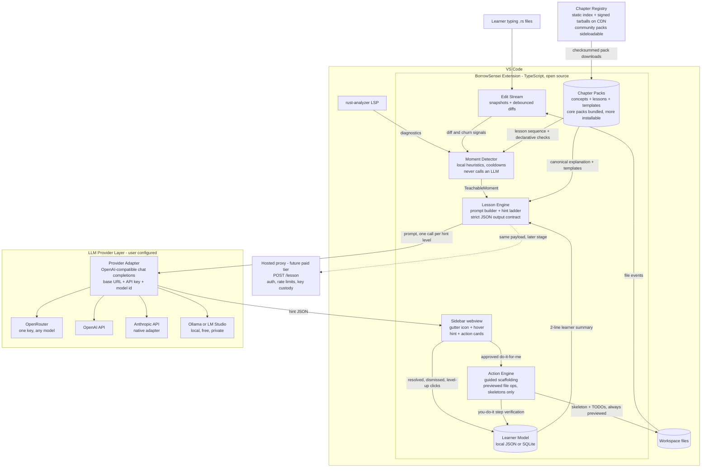

# System Design: Rust Pair-Teacher VS Code Extension

Working name: **BorrowSensei** (placeholder). An open source, editor-native AI tutor that watches free-form Rust code, detects teachable moments, and teaches with tiered hints instead of writing code. Provider-agnostic: bring any OpenAI-compatible key (OpenRouter, OpenAI), an Anthropic key, or a free local model via Ollama.

Design informed by the market research: the whitespace is editor-native watching + Rust-first pedagogy + hint ladder + longitudinal concept tracking. The build must be solo-dev sized, validate the "teachable moment" heuristic early, and keep costs near zero until it proves itself.

---

## 1. Requirements

### Functional
- **F1. Watch**: Observe edits to `.rs` files in real time (keystroke stream, debounced) and on save. No screen capture; editor APIs only.
- **F2. Detect teachable moments**: Trigger on (a) a rust-analyzer diagnostic that lingers past a threshold, (b) repeated delete/rewrite churn in one region, (c) idle-after-error, (d) first-ever occurrence of an error code for this learner, (e) explicit user invocation ("explain this like a teacher").
- **F3. Teach with a hint ladder**: Level 1 Socratic question, Level 2 reframed error in the learner's own code terms, Level 3 worked example. Never jump levels without a user click. Never writes solution code into the learner's buffer (scaffolding is the one narrow exception, see F7).
- **F4. Track concept mastery**: Maintain a per-learner model mapping concepts (ownership, borrows, lifetimes, traits, error handling, etc.) to struggle/mastery scores, updated after every teachable moment and resolution.
- **F5. Idiom flagging**: Occasionally flag compiling-but-non-idiomatic patterns (e.g. reflexive `.clone()` to dodge the borrow checker) as low-priority lessons.
- **F6. On-demand mode**: Everything above must also work purely on request, for users who find ambient nudges noisy (research flagged this as the make-or-break UX risk).
- **F7. Guided scaffolding**: When a lesson needs project structure (a new file, a module, a test file, a `cargo` command), the teacher proposes an **action card** with two paths. "You do it" (default): numbered steps the learner performs, with the watcher live-verifying each one. "Do it for me" (explicit per-action click): the extension creates the file after a preview, containing only a commented skeleton with `todo!()` markers, then narrates exactly what it did. The learner drives, the teacher suggests; solution code is never generated in either path.
- **F8. Chapter packs**: Teaching content ships as versioned, downloadable **chapter packs** that install into the extension independently of extension releases. A chapter bundles concept entries, a lesson sequence (guided exercises with scaffolds and declarative completion checks), Socratic templates, and worked examples. Core chapters come bundled; more are fetched from a registry; authors can sideload a local pack. New pedagogy must never require a new extension version.
- **F8. Whole-lifecycle interventions**: Teaching moments are not only compiler errors. The same trigger-card-verify grammar covers session warm-ups, just-ahead concept previews, success recognition, test coaching, clippy-as-curriculum, rabbit-hole rescue, prediction challenges, session recaps, and spaced review (catalog in 3.8).
- **F9. Scaffold fading**: As a concept's mastery score rises, the teacher deliberately goes quieter on it: fewer ambient nudges, hint ladder starts higher, eventually silence unless asked. A teacher whose goal is their own obsolescence is the anti-autocomplete principle applied over time.

### Non-functional
- **N1. Latency**: A hint should render within ~3–5 s of trigger. The *detection* itself must be near-instant and fully local.
- **N2. Cost**: Target < $0.02 per teachable moment; expect 5–15 moments/hour of active learning. Detection must never call the LLM; only teaching does.
- **N3. Privacy**: Code snippets leave the machine only when a moment fires, only the relevant region plus minimal context, and this must be visible/controllable. Learner model stays local by default.
- **N4. Reliability**: LLM outage degrades gracefully to `rustc --explain` text plus the stored concept explanation. The extension must never block typing or the rust-analyzer pipeline.
- **N5. Interruption budget**: Hard cap on ambient nudges (e.g. max 1 per 3 minutes, snoozeable), because "noisy autocomplete" is the documented failure mode of this category.

### Constraints
- Solo developer, evenings/weekends. TypeScript for the extension (v1), which conveniently is not Rust, leaving the Rust learning to the *usage* of the tool, with an optional v2 backend rewrite in Rust as a capstone project.
- VS Code only for v1. rust-analyzer assumed installed (it is the default Rust setup).
- **Open source, provider-agnostic.** MVP ships with bring-your-own credentials against any OpenAI-compatible endpoint (OpenRouter, OpenAI, Anthropic via native adapter, or local Ollama/LM Studio at zero cost). A thin proxy backend comes only at monetization.
- **No subscription piggybacking.** Claude Pro/Max OAuth is contractually restricted to Claude Code and claude.ai (enforced server-side since Jan 2026), and ChatGPT subscriptions cover only OpenAI's own Codex products, not third-party API use. Wrapping either vendor's CLI as a backend is the pattern that got banned; the extension will not depend on it.

---

## 2. High-Level Design

### Master system diagram



Everything to the left of the Provider Adapter is local and free. The only network egress is a fired teachable moment, and with Ollama even that stays on the machine.

### Data flow (happy path)
1. Learner types; the Edit Stream keeps a rolling snapshot per file and a debounced diff (idle threshold ~8 s, plus on-save).
2. rust-analyzer publishes diagnostics; the extension reads them via `vscode.languages.getDiagnostics(uri)`.
3. Moment Detector runs cheap local heuristics over (diff churn, diagnostic age, error-code novelty vs learner model, idle time). Emits at most one `TeachableMoment` per cooldown window.
4. Lesson Engine builds a prompt: the diagnostic(s), the relevant code region (enclosing function, not the whole file), the diff that led here, the mapped concept, and a two-line learner-model summary ("has struggled with E0502 3x this week, prefers analogies"). Calls the LLM requesting **Level 1 only**.
5. Sidebar renders the Socratic question. Buttons: "another nudge" (L2), "show me a worked example" (L3), "I solved it", "not now".
6. On resolution (diagnostic clears, or learner marks solved/dismissed), the Learner Model updates the concept score and logs the episode.

---

## 3. Deep Dive

### 3.1 Concept taxonomy and error-code mapping
A static table shipped with the extension, adapted from the Brown University conceptual model. Roughly:

| Concept | Signals |
|---|---|
| ownership / moves | E0382, E0505; `.clone()` churn |
| shared vs mutable borrows | E0499, E0502 |
| borrow lifetimes / dangling | E0597, E0515, E0716, E0106 |
| traits and bounds | E0277, E0308 (subset) |
| pattern matching / Option-Result | E0004, `unwrap()` density |
| idioms (non-error) | clippy lints, heuristic AST patterns |

This table is the pedagogical core and the cheapest moat to start building: every entry gets a canonical mental-model explanation, 2–3 Socratic question templates, and a worked-example template. The LLM personalizes; the table keeps it grounded.

### 3.2 Learner model (data model)
Local JSON (v1) or SQLite (v1.5) in `globalStorageUri`:

```jsonc
{
  "learner": { "created": "...", "preferences": { "analogies": true, "ambient": true } },
  "concepts": {
    "mutable_borrows": {
      "score": 0.35,            // 0 = struggling, 1 = mastered, EWMA
      "encounters": 7,
      "lastSeen": "2026-08-06",
      "unresolvedStreak": 2
    }
  },
  "episodes": [
    { "ts": "...", "concept": "mutable_borrows", "errorCodes": ["E0502"],
      "hintLevelReached": 2, "resolvedBy": "self", "durationSec": 240 }
  ]
}
```

Score update: exponentially weighted, `resolvedBy: self` at hint level 1 moves the score up strongly; reaching level 3 or abandoning moves it down. `unresolvedStreak >= 3` on a concept triggers a proactive mini-lesson offer next session. Scores also decay slowly over calendar time (fuels spaced review, 3.8) and drive scaffold fading (F9): the score is not just a report card, it is the volume knob on the teacher's voice per concept. Episodes cap at ~500 with rollup summaries, since this file rides along in prompts.

### 3.3 Prompting contract (the "API" of v1)
There is no server API in the MVP; the contract is the prompt schema:

- **System prompt**: role (teacher, never writes code into the buffer, never gives the answer at level 1–2), the concept's canonical explanation from the table, the learner summary, strict output format (JSON: `{question, level, conceptTag, confidence}`).
- **User turn**: diagnostic text, code region, diff summary, requested hint level.
- One call per hint level (levels are separate calls so cost tracks engagement, and level 3 can use a bigger model if needed).

When a proxy backend appears (monetization stage), it exposes exactly one endpoint, `POST /lesson`, taking this same payload, adding auth, rate limits, and key custody. Stateless; the learner model stays client-side and only a summary travels.

### 3.3b LLM Provider Layer
A single `ProviderAdapter` interface: `complete(messages, opts) -> {json, usage}`. Two implementations:

- **OpenAI-compatible** (the workhorse): configurable `baseUrl`, `apiKey`, `model`. This one config covers OpenRouter, OpenAI, Groq, DeepSeek, Ollama (`http://localhost:11434/v1`), and LM Studio. Settings UI offers presets for OpenRouter and Ollama since those are the two recommended paths (cheapest hosted, and free local).
- **Anthropic native** (optional): for users who prefer a Console key directly.

Constraints the adapter enforces regardless of provider: strict JSON output (with one repair retry), a token ceiling per hint level, and the daily call budget. Model quality varies wildly at the bottom end, so the settings page carries an honest note: hint levels 1–2 work fine on small local models; level 3 worked examples benefit from a stronger model, and the two can be configured separately (`modelFast`, `modelDeep`).

Explicitly rejected: authenticating through Claude Pro/Max or ChatGPT subscriptions. Both vendors restrict subscription auth to their own products (Anthropic by enforced ToS since Feb 2026, OpenAI by scoping subscription sign-in to Codex), and an open source project inviting users to violate ToS would put their accounts at risk.

### 3.4 Moment Detector heuristics (all local, tunable)
- `diagnosticAge > 20s` AND learner idle `> 8s` → candidate.
- Same 5-line region rewritten `>= 3` times in 2 minutes → candidate ("churn").
- Error code never seen before by this learner → candidate with priority boost.
- Cooldown: 3 min global, 10 min per concept. On-demand command bypasses all of it.
- Every fired/suppressed candidate is logged locally; this log is the Stage-1 validation dataset for whether the heuristics feel right.

### 3.5 Caching and cost control
- Concept explanations and worked-example templates: shipped statically, zero cost.
- LLM responses cached keyed on (error code, normalized code shape hash, hint level) with a short TTL; re-hitting E0502 on the same line after a failed fix should not re-bill.
- Hard daily spend guard in settings (e.g. 50 calls/day default on BYO key).

### 3.6 Error handling
- LLM call fails or times out (5 s): render the static concept explanation plus `rustc --explain` output, tagged "offline hint". Never a spinner that blocks.
- rust-analyzer absent: extension politely deactivates ambient mode, on-demand still works with compiler output from `cargo check` if available.
- Malformed LLM JSON: one retry with a repair instruction, then fall back to static.

### 3.7 Guided scaffolding and file actions
Lessons sometimes need structure: a new module file, a test file, a `cargo add`. The Lesson Engine can emit an **action card** alongside a hint. Every action card offers the same two paths:

- **You do it (default).** Numbered steps in the sidebar ("create `src/parser.rs`", "add `mod parser;` to `main.rs`", "run `cargo add serde`"). Because the Edit Stream already watches files and diffs, each step gets a live checkmark as the learner completes it. The verification loop is itself a teaching device: the learner performs every action with their own hands, and the checkmark confirms shared understanding of what just happened.
- **Do it for me (explicit click, per action, never a global mode).** The Action Engine creates the file via `vscode.workspace.fs` after showing a preview, containing only a commented skeleton: the module declaration, a doc comment explaining why this file exists, and `todo!()` markers where the learner writes the real code. It then narrates exactly what it created and why, and the step list collapses into a "what happened" trail so nothing is ever mysterious.

Hard rules for both paths: no function bodies beyond `todo!()`, no solution code, never modifies an existing file without a preview diff and explicit confirmation, all operations workspace-scoped and logged in the trail. Completed you-do-it steps feed the learner model exactly like hint resolutions, because project structure is a concept domain of its own: `mod`/`use` confusion, visibility, and E0433/E0603 are a classic beginner wall and get their own concept-table entries.

### 3.8 Chapter packs (content distribution)
The unifying move: **the built-in concept table is itself just chapter pack zero.** One pack format, one loader, and "shipping a lesson" never requires shipping an extension update.

**Pack format** (a tarball of declarative content, no executable code):

```
ownership-101/
  chapter.toml          # id, semver, schemaVersion, title, prerequisites: []
  concepts/*.md         # canonical explanations, front-matter: errorCodes, socraticTemplates
  lessons/01-moves/
    lesson.md           # narrative + goal
    scaffold/           # starter files, todo!() only (the Action Engine deploys these)
    checks.toml         # declarative completion checks
  examples/*.rs         # worked examples for hint level 3
```

`checks.toml` reuses machinery that already exists: `diagnostic_cleared = "E0382"`, `cargo_test_passes = true`, `file_exists = "src/lib.rs"`, `no_pattern = "\\.clone\\(\\)"`. The Moment Detector evaluates them the same way it watches free-form code, so lessons are Rustlings-style but taught by the same tiered-hint engine, and lesson struggles update the same learner model.

**Distribution**: core packs bundled in the `.vsix`; the registry is a static JSON index plus tarballs on a CDN (GitHub Releases is fine for v1), fetched over HTTPS and verified by checksum, with signing added before community submissions open. `Install from folder` supports authors and classrooms (a university course can distribute its own chapter privately). Installed packs live in `globalStorageUri`, keyed by id and version; the learner model records progress per `chapterId/lessonId`.

**Security stance**: packs are data, never code. No JS, no shell commands in checks (`cargo test` and `cargo check` are the only permitted executions, and they run the *learner's own* project, which is already the trust boundary of using an editor). Schema-validated on install; unknown fields rejected noisily so schemaVersion drift is visible.

**Why this matters commercially**: chapters are the natural monetization unit the research pointed at. The extension, engine, and core borrow-checker chapters stay open and free forever; deep specialty chapters (async Rust, unsafe, embedded) can be paid packs later without touching the open-core boundary.

### 3.8 The full teaching lifecycle
Every intervention in the product follows one grammar: **local trigger → suggestion card → learner acts → watcher verifies → learner model updates**. Errors are just the most obvious trigger. The catalog, by stage:

| Stage | Trigger (all local) | Teacher move | Learner drives by |
|---|---|---|---|
| First run | No learner model exists | Two-minute placement: 3 "does this compile?" predictions | Answering; skippable entirely |
| Session start | Concept with low score + `unresolvedStreak` from last session | Offers a 2-min warm-up question on it | Accepting, snoozing, or disabling warm-ups |
| Project choice | Learner asks, or empty workspace | Suggests a project sized to current mastery ("CLI todo app exercises structs + Result") | Picking; teacher never generates the project |
| Just-ahead preview | First-ever appearance of a construct in the diff (first `impl`, first `<'a>`, first `async`) | "New territory. Want a 60-second primer *before* the errors?" | Accepting or declining; declining is data too |
| Success recognition | Diagnostic for a known-struggle concept resolved with zero hints | One-line acknowledgment, mastery score bump, nothing else | Nothing; this card never asks for interaction |
| Idiom challenge | Compiling but non-idiomatic pattern (clone-to-dodge-borrow, unwrap density, manual index loops) | "This works. Want to try the idiomatic version as a challenge?" Reveal only after an attempt | Attempting the refactor first |
| Rabbit-hole rescue | Same region churning past ~15 min, ladder exhausted | Suggests decomposition: comment out, shrink to a compiling core, rebuild | Doing the simplification themselves |
| Test coaching | New function compiles; no `#[cfg(test)]` in file | Action card: test skeleton steps + edge cases posed as questions ("what if the vec is empty?") | Writing every assertion |
| Debugging | Test fails or runtime panic | Teaches backtrace reading and a `dbg!` probe strategy; never names the bug | Placing probes, forming the hypothesis |
| Clippy curriculum | Clippy run (quiet, batched) | Surfaces exactly ONE lint, chosen to match the current learning focus, as a lesson | Fixing it; remaining lints stay hidden |
| Error-literacy | Early sessions, any rustc error | Meta-lesson on reading the error itself: spans, notes, `help:` lines | Locating the answer inside the compiler output |
| Reading practice | Concept recently mastered | Suggests reading a short real-crate snippet using it, with comprehension questions | Reading and answering |
| Session end | Editor idle/close after an active session | Recap: concepts hit, solo-solve count, one takeaway | Optional one-line "what I learned" journal entry |
| Spaced review | Concept score decayed over days | Resurfaces as a prediction card ("will this compile?") in the sidebar, never a popup | Predicting; 10 seconds max |
| Graduation | Concept crosses mastery threshold | Announces the fade: hints for this concept now start at level 2, ambient nudges stop | Can re-enable per concept anytime |

Three design notes. **Prediction cards are the cheapest powerful tool here**: "does this compile?" costs one static snippet and ten learner-seconds, is validated pedagogy (self-testing beats re-reading), and works offline from the concept table with no LLM call. **Positive triggers matter as much as errors**: a model that only ever speaks when something is wrong trains the learner to dread the sidebar; success recognition and graduation announcements keep the relationship a teacher's, not a linter's. **Every ambient row above shares the interruption budget from N5**, and each card type has its own toggle, because the lifecycle catalog is also a catalog of ways to be annoying.

---

## 4. Scale and Reliability

Honest load estimate: this is a client-heavy, single-user-at-a-time system. One active learner ≈ 5–15 LLM calls/hour ≈ $0.10–0.30/hour on a mid-tier model with small prompts. At 1,000 weekly-active learners on a future proxy, that is a boring stateless Node/Rust service behind a queue-less request path; the only real scaling concern is API key spend, which the per-user rate limits already bound. No database on the server until cloud sync ships; when it does, it is a single `learner_model` table keyed by user, synced last-write-wins (concept scores are mergeable by max-recency, episodes append-only).

Reliability priorities in order: (1) never degrade the editing experience, (2) never lose the learner model (write-ahead to a temp file, atomic rename), (3) graceful LLM degradation. Monitoring in v1 is opt-in local telemetry export (moment counts, hint-level distribution, resolution rates), which doubles as the product-validation instrument for Stage 1.

---

## 5. Trade-off Analysis

**VS Code extension vs LSP-agnostic sidecar.** An LSP-agnostic design (own process speaking to any editor) is more elegant and future-proof (Neovim, Zed) but roughly triples v1 scope. Decision: VS Code-native now, but keep the Moment Detector and Lesson Engine in editor-independent modules so a sidecar extraction later is a refactor, not a rewrite.

**BYO credentials vs proxy backend.** BYO means zero infra, zero cost, faster ship, and a self-selecting technical early audience; it also blocks mainstream users and makes a paid tier impossible. The provider-agnostic adapter softens the friction substantially (a learner with no API accounts can run Ollama for free), and open source plus BYO builds the community that a later hosted tier converts from. Decision: BYO for Stages 1–2, proxy only when the research plan's retention benchmark is met. Open sourcing the extension while keeping the future proxy and any premium concept-content closed remains available as the standard open-core play.

**Provider-agnostic vs single-vendor.** One vendor means simpler prompt tuning and predictable output quality; provider-agnostic means testing across models, tolerating weak local models, and a JSON contract that must survive all of them. Decision: provider-agnostic via the OpenAI-compatible surface, because the audience (learners, cost-sensitive, some privacy-minded) and the open source positioning both demand it, and because the concept table grounding reduces dependence on any one model's quality.

**Ambient watching vs on-demand.** Ambient is the differentiator but also the documented failure mode (noise). Decision: ship both, default ambient ON with the strict interruption budget, and instrument the toggle. If most users turn ambient off in week one, the product pivots to "on-demand teacher" and the detector becomes a badge counter instead of a notifier.

**Static concept table vs pure LLM.** Pure LLM is faster to build and broader; the table is work but gives grounded, consistent pedagogy, offline fallback, cacheability, and is the defensible asset. Decision: table-grounded, LLM-personalized. Revisit if maintaining the table beyond ~30 concepts becomes the bottleneck.

**Local learner model vs cloud.** Local is private, free, and fine for one machine; it sacrifices sync and aggregate learning insights. Decision: local until users ask for sync, which is itself a paid-tier feature per the research's monetization framing.

**Webview sidebar vs inline decorations.** Inline (CodeLens, hover, comments) feels more "pair partner" but competes for space with rust-analyzer's own inlays and risks clutter. Decision: sidebar as the teaching surface, one subtle gutter icon as the ambient signal, hover only for "what concept is this".

**Guide-first vs do-it-for-me.** Letting the teacher touch the filesystem at all risks sliding toward the autocomplete pattern the product defines itself against, and every contributor PR will push toward more agency because agentic editors have set that expectation. But refusing all agency makes multi-file lessons tedious and patronizing for structure-only chores. Decision: you-do-it default, do-it-for-me as per-action opt-in that is skeleton-only, previewed, and narrated. The bright line for code review and contributors: the teacher may build the classroom, never write the essay.

**Declarative packs vs executable plugins.** Executable chapter plugins (JS hooks, custom checkers) would be maximally flexible and are what a plugin ecosystem usually becomes; they are also a supply-chain attack surface and a review burden an open source solo project cannot carry. Decision: packs are pure data with a fixed check vocabulary. If a lesson genuinely cannot be expressed declaratively, the check vocabulary grows by an extension release, which is the right pressure valve: the extension is reviewed code, packs are not. Revisit only if the vocabulary churns constantly.

**Own registry vs VS Code Marketplace extension-packs.** Publishing each chapter as a Marketplace extension would outsource hosting and updates but couples content to Microsoft's review latency, makes packs code-shaped (wrong trust model), and breaks on other editors after the sidecar extraction. Decision: own static registry, boring by design (JSON index + tarballs on GitHub Releases), upgradeable to a real backend only if community volume demands it.

---

## 6. What to revisit as it grows
- Extract Detector + Lesson Engine into an editor-agnostic core (enables Neovim/Zed, and the Rust rewrite).
- Replace heuristic churn detection with tree-sitter-based region tracking once heuristics prove directionally right.
- Concept table licensing conversation with the Brown Cognitive Engineering Lab before the pedagogy layer deepens.
- Chapter registry maturity: checksums → signing → community submission review, only as pack volume demands.
- Multi-language expansion (the concept-table + detector architecture generalizes; Rust stays the wedge). Seams specified in [language-extensibility.md](language-extensibility.md) — four of them touch *persisted* formats (diagnostic signatures, namespaced concept ids, the check vocabulary, cache keys) and so must land in v1, while the `LanguageProvider` interface itself deliberately waits for a real second language.
- If JetBrains or GitHub ship ambient tutoring, collapse scope to the deepest borrow-checker teacher and evaluate partnership over competition.

## 7. Build order (maps to the research's Stage 1)
1. Edit Stream + snapshot/diff (weekend 1).
2. Diagnostics reader + Moment Detector with logging, no LLM yet; dogfood the trigger feel (weekend 2).
3. Concept content for the 7 borrow-checker codes, authored in the chapter-pack format from day one (pack zero) with a minimal loader + Lesson Engine + sidebar, BYO credentials (weekends 3–4). The registry comes much later; the format comes first so nothing needs migrating.
4. Learner model + hint-ladder buttons + resolution tracking, plus you-do-it action cards with step verification (weekend 5). Do-it-for-me file creation comes after, since it depends on the preview/trail UI.
5. Marketplace listing, recruit 20–50 learners from r/rust and Rustlings/Exercism communities, instrument the two Stage-1 questions.
